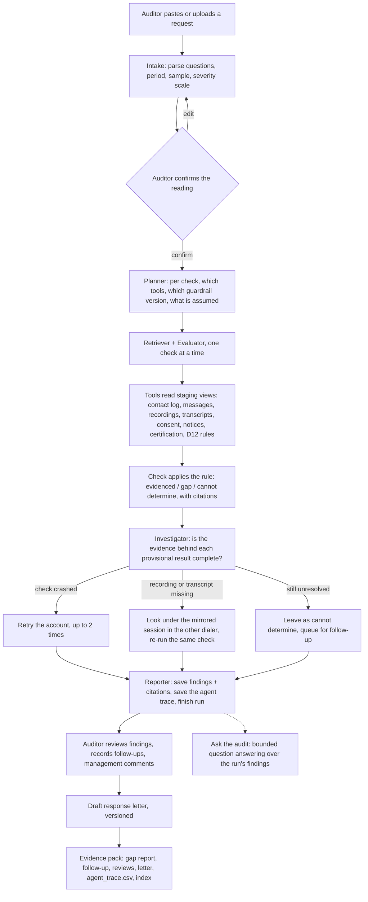

# Workflow: how the platform runs an audit

The platform is an agent with a fixed, bounded loop. Language models read text; **pass or fail is always decided by deterministic checks** (D-007, D-020), and every result carries cited records.

## Roles (code in `agent/runtime/`)

| Role | Module | Does | Never does |
|---|---|---|---|
| Parser | `agent/intake` | Reads the request into checks, period, sample size; flags low confidence | Runs a check |
| Planner | `runtime/planner.py` | Writes the plan to the trace: tools per check (declared by each check's `tools`), guardrail version, assumptions, unmatched references | Retrieves data |
| Retriever | `agent/tools/*` via `core/toolkit.py` | Reads staging views through the read-only role; each call is timed, counted and attributed to a check | Decides a result |
| Evaluator | `agent/checks/*` | Applies the rule; one finding per breaching event; cites every record | Uses a model |
| Investigator | `runtime/investigator.py` | Retries failed accounts; looks for a recording or transcript under the mirrored session; re-runs the same check | Turns a gap into a pass by judgement; hides a gap |
| Orchestrator | `runtime/orchestrator.py` | Order of work, trace, saving | Decides results |
| Reporter | `agent/services` (`store.py`, `pack.py`) | Saves findings, builds the letter and pack | Edits findings after completion |
| Ask the audit | `runtime/qa.py` | Answers questions from the run's findings; rejects an answer that cites a finding no query returned | Writes or re-tests |

## Bounds and honest outcomes

- One pass per check; at most 2 retries per failed account; one mirror lookup per provisional call; question answering stops after 4 steps.
- Missing evidence is `cannot determine`, never `evidenced` (CLAUDE.md rule 1). Whatever the investigator cannot settle goes to the follow-up queue.
- The trace (`audit.agent_steps`) is saved with the run and exported in the pack as `agent_trace.csv`, so a reviewer can see what the agent intended, called and concluded.

## Modules

`agent/checks` (one module per check, plus `catalog.py` for titles and meanings) · `agent/tools` (one module per source) · `agent/runtime` (planner, investigator, orchestrator, QA) · `agent/services/audit.py` (the use case) and `agent/intake` (parsing and sampling) · `agent/web/routers/*` (one router per area) · `agent/web/static/js/*` (one script per page).
